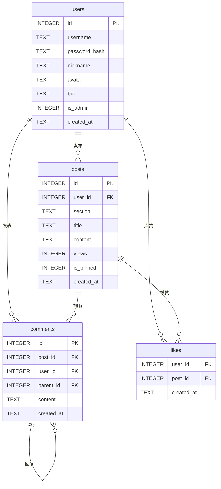
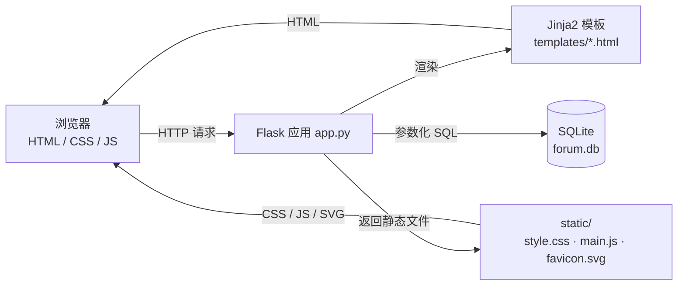

# 校园论坛

[](https://www.python.org/)
[](https://flask.palletsprojects.com/)
[](https://jinja.palletsprojects.com/)
[](https://www.sqlite.org/)
[](https://werkzeug.palletsprojects.com/)
[](https://developer.mozilla.org/zh-CN/docs/Web/HTML)
[](https://developer.mozilla.org/zh-CN/docs/Web/CSS)
[](https://developer.mozilla.org/zh-CN/docs/Web/JavaScript)
[](https://www.python.org/downloads/)

一个基于 Flask + SQLite 的轻量级校园论坛。单文件后端、零前端构建、零外部 CDN，开箱即可运行。包含注册登录、板块浏览、发帖、评论与回复、点赞、搜索、热门排序、个人主页、资料与密码设置，以及管理员置顶和内容管理。

---

## 目录

- [功能特性](#功能特性)
- [技术栈与依赖](#技术栈与依赖)
- [项目结构](#项目结构)
- [快速开始](#快速开始)
- [页面与操作说明](#页面与操作说明)
- [路由一览](#路由一览)
- [数据库设计](#数据库设计)
- [系统架构](#系统架构)
- [安全与健壮性设计](#安全与健壮性设计)
- [配置项](#配置项)
- [常见问题](#常见问题)
- [已知限制](#已知限制)
- [作者与联系方式](#作者与联系方式)

---

## 功能特性

### 账号
- 注册、登录、退出登录
- 用户名 2–20 位（字母、数字、下划线或中文），密码至少 6 位
- 昵称 1–20 字，个人签名最长 100 字
- 8 种头像配色可选，头像以"昵称首字 + 色块"呈现，不使用图片上传
- 首位注册用户自动成为管理员
- 修改密码需校验原密码

### 内容
- 6 个固定板块：学习交流、校园生活、二手交易、失物招领、活动通知、灌水闲聊
- 发帖（板块 + 标题 2–60 字 + 正文至少 5 字）
- 帖子详情、浏览量统计、按最新/热门排序
- 评论与二级回复（回复某条评论时显示"回复 @昵称"）
- 点赞 / 取消点赞，前端无刷新切换（返回 JSON）
- 关键词搜索（标题 + 正文）
- 分页，每页 15 条

### 管理与个人中心
- 作者可删除自己的帖子/评论，管理员可删除任意帖子/评论
- 管理员可置顶 / 取消置顶
- 个人主页展示资料、发帖数、评论数与发帖列表
- 个人设置支持修改昵称、头像配色、签名和密码

### 交互与视觉
- 导航栏常显"退出"按钮，帖子详情页提供"← 返回"与"返回板块"
- 顶部导航栏搜索框、板块标签、排序切换、分页
- Flash 提示消息 3 秒后自动淡出
- 删除操作二次确认
- 响应式布局，适配 900px / 620px 两个断点

---

## 技术栈与依赖

### 运行依赖

| 依赖 | 版本要求 | 说明 |
| --- | --- | --- |
| Python | 3.9+（开发环境 3.11.9） | 运行解释器 |
| Flask | >= 3.0（开发环境 3.1.3，见 `requirements.txt`） | Web 框架与路由 |
| Werkzeug | 随 Flask 安装 | `generate_password_hash` / `check_password_hash` 密码哈希 |
| Jinja2 | 随 Flask 安装 | 模板引擎与自定义过滤器（`timeago`、`excerpt`） |
| SQLite | Python 内置 `sqlite3` | 数据存储，无需额外安装 |
| HTML5 / CSS3 / JavaScript (ES6) | 浏览器原生支持 | 前端，无框架、无打包、无 CDN |

前端不依赖任何第三方库：样式手写于 `static/css/style.css`，交互手写于 `static/js/main.js`，图标为模板宏生成的内联 SVG。

### 安装

```bash
# 1. 创建并激活虚拟环境（可选，但推荐）
python -m venv .venv
# Windows PowerShell
.venv\Scripts\Activate.ps1
# macOS / Linux
source .venv/bin/activate

# 2. 安装依赖
pip install -r requirements.txt
```

`requirements.txt` 内容：

```text
flask>=3.0
```

---

## 项目结构

```text
校园论坛/
├── app.py                  # 全部后端逻辑：数据库、认证、路由、模板过滤器
├── forum.db                # SQLite 数据库（首次启动自动创建）
├── requirements.txt        # Python 依赖声明
├── static/
│   ├── css/
│   │   └── style.css       # 全站样式（实色配色、细边框、无渐变）
│   ├── js/
│   │   └── main.js         # Flash 淡出、删除确认、点赞、评论回复
│   └── favicon.svg         # 站点图标（内联 SVG）
└── templates/
    ├── base.html           # 基础布局：导航栏、Flash、页脚
    ├── _ui.html            # 宏库：线性图标 icon / 文字头像 avatar / 板块徽章
    ├── index.html          # 首页：板块标签、排序、帖子列表、侧栏、分页
    ├── post_detail.html    # 详情：返回按钮、正文、点赞、评论与回复
    ├── new_post.html       # 发帖
    ├── user_home.html      # 个人主页
    ├── settings.html       # 资料与密码设置
    ├── login.html          # 登录
    ├── register.html       # 注册
    └── error.html          # 403 / 404 错误页
```

---

## 快速开始

```bash
# 在项目根目录执行
python app.py
```

启动后终端输出：

```text
——————————————————————————————————————————————
校园论坛已启动！
请在浏览器访问：http://127.0.0.1:5000 ！
第一位注册的用户将自动成为管理员！
——————————————————————————————————————————————
```

浏览器访问 <http://127.0.0.1:5000>，先注册一个账号（第一个注册的账号即管理员），随后即可发帖、评论和点赞。


### 数据库初始化与重置

- 首次运行 `python app.py` 时会自动执行建表逻辑（`init_db()`），无需手动建库。
- 想清空所有数据：停止服务，删除项目根目录下的 `forum.db`，再次启动即可重新建库。
- 旧版本遗留的 emoji 头像数据会在启动时自动迁移为配色名（`rose` 等），不会报错。

### 端口修改

默认监听 `127.0.0.1:5000`。如需修改端口，编辑 [app.py](app.py) 末尾：

```python
app.run(host="127.0.0.1", port=5000, debug=False);
```

---

## 页面与操作说明

| 页面 | 路径 | 说明 |
| --- | --- | --- |
| 首页 | `/` | 板块筛选、关键词搜索、最新/热门排序、分页、论坛概况与热门讨论 |
| 帖子详情 | `/post/<id>` | 正文、浏览量、点赞、删除（有权限时）、置顶（管理员）、评论与回复 |
| 发帖 | `/post/new` | 选择板块，填写标题与正文 |
| 个人主页 | `/user/<id>` | 资料、发帖数、评论数、该用户的帖子列表 |
| 个人设置 | `/settings` | 修改昵称、头像配色、签名；单独表单修改密码 |
| 登录 / 注册 | `/login`、`/register` | 已登录访问会自动跳回首页 |
| 错误页 | 403 / 404 | 统一的错误提示与返回首页入口 |

界面要点：

- 首页板块切换为"文字 + 底部横线"标签，选中项下方显示粉色横线。
- 帖子卡片展示作者头像、板块徽章、标题、摘要、时间与浏览/点赞/评论数。
- 帖子详情页左上角常显"← 返回"按钮（优先返回浏览器上一页，否则回首页），旁边提供"返回「当前板块」"。
- 登录用户可在导航栏直接看到"退出"按钮（图标 + 文字），设置入口为齿轮图标。
- 未登录时点赞会跳转登录页，登录后自动回到原页面。

---

## 路由一览

| 方法 | 路径 | 功能 | 权限 |
| --- | --- | --- | --- |
| GET | `/` | 帖子列表（板块 / 搜索 / 排序 / 分页） | 公开 |
| GET, POST | `/register` | 注册 | 未登录 |
| GET, POST | `/login` | 登录（支持站内 `next` 回跳） | 未登录 |
| GET | `/logout` | 退出登录 | 公开 |
| GET, POST | `/post/new` | 发布帖子 | 登录 |
| GET | `/post/<id>` | 帖子详情（浏览量 +1） | 公开 |
| POST | `/post/<id>/comment` | 发表评论 / 回复 | 登录 |
| POST | `/post/<id>/like` | 点赞切换，返回 JSON | 登录 |
| POST | `/post/<id>/delete` | 删除帖子 | 作者或管理员 |
| POST | `/post/<id>/pin` | 置顶 / 取消置顶 | 管理员 |
| POST | `/comment/<id>/delete` | 删除评论 | 作者或管理员 |
| GET | `/user/<id>` | 用户主页 | 公开 |
| GET, POST | `/settings` | 修改资料 / 密码 | 登录 |

未登录访问受保护页面时，会写入一条 Flash 提示并跳转 `/login?next=原路径`；权限不足返回 403 页面。

---

## 数据库设计

四张表：`users`、`posts`、`comments`、`likes`。外键约束在每次请求连接时通过 `PRAGMA foreign_keys = ON` 开启。



字段说明：

| 表 | 字段 | 类型 | 说明 |
| --- | --- | --- | --- |
| `users` | `id` | INTEGER PK | 自增主键 |
| | `username` | TEXT UNIQUE | 登录名，唯一 |
| | `password_hash` | TEXT | Werkzeug 哈希后的密码，不存明文 |
| | `nickname` | TEXT | 展示昵称 |
| | `avatar` | TEXT | 头像配色名，默认 `rose` |
| | `bio` | TEXT | 个性签名，默认空串 |
| | `is_admin` | INTEGER | 1 表示管理员，首位注册用户为 1 |
| | `created_at` | TEXT | `YYYY-MM-DD HH:MM:SS` |
| `posts` | `user_id` | INTEGER FK | 作者，引用 `users.id` |
| | `section` | TEXT | 板块名，取值受后端白名单约束 |
| | `views` | INTEGER | 浏览量 |
| | `is_pinned` | INTEGER | 是否置顶 |
| `comments` | `post_id` | INTEGER FK | 所属帖子，`ON DELETE CASCADE` |
| | `parent_id` | INTEGER FK | 被回复评论，自引用，可空 |
| `likes` | `user_id` + `post_id` | 复合主键 | 同一用户对同一帖子只能点一次赞 |

索引：`idx_posts_section(section)`、`idx_comments_post(post_id)`。时间统一以 `%Y-%m-%d %H:%M:%S` 字符串存储，配合 `timeago` 过滤器显示为"刚刚 / 分钟前 / 小时前 / 天前 / 日期"。

---

## 系统架构



请求处理流程：

1. `before_request` 从会话读取 `user_id`，加载当前用户到 `g.user`。
2. 视图函数通过 `get_db()` 获取同一请求内复用的连接（开启外键、`Row` 行工厂）。
3. `login_required` / `admin_required` 装饰器做权限拦截。
4. 视图查询数据后交给 Jinja2 模板渲染，模板复用 `_ui.html` 中的图标与头像宏。
5. 请求结束由 `teardown_appcontext` 关闭数据库连接。

---

## 安全与健壮性设计

- **密码**：仅存 `generate_password_hash` 的结果，登录用 `check_password_hash` 校验。
- **SQL 注入**：所有查询使用参数化占位符；动态条件只拼接白名单字段。
- **搜索通配符**：对 `%`、`_`、`\` 做转义并使用 `ESCAPE '\'`，避免搜索 `%` 时命中全部帖子。
- **开放重定向**：登录 `next` 仅允许以单个 `/` 开头的站内路径，同时拒绝 `//` 与反斜杠形式。
- **XSS**：模板默认自动转义，正文以纯文本展示（`white-space: pre-wrap` 保留换行），不渲染 HTML。
- **越权**：删除帖子/评论校验作者或管理员身份，置顶仅管理员，越权返回 403。
- **外键约束**：删除帖子前先解除评论自引用，删除评论前先解除子评论引用，避免级联过程中触发约束失败；帖子的评论与点赞由 `ON DELETE CASCADE` 清理。
- **输入校验**：用户名格式、昵称长度、密码长度、标题长度、正文长度、签名长度、板块白名单、`parent_id` 归属均在服务端校验，不依赖前端。
- **参数容错**：非法页码（如 `?page=abc`）、非法排序参数、未知板块、伪造的跨帖回复目标都会安全降级，不会 500。
- **会话清理**：用户被删除后，下次请求会清空失效会话。

---

## 配置项

| 配置 | 位置 | 当前值 | 说明 |
| --- | --- | --- | --- |
| `SECRET_KEY` | `app.py` | `campus-forum-secret-key-2024` | 会话签名密钥，正式部署前请替换为环境变量 |
| `DATABASE` | `app.py` | `项目根目录/forum.db` | SQLite 文件路径 |
| `PAGE_SIZE` | `app.py` | `15` | 列表每页条数 |
| `SECTIONS` | `app.py` | 6 个板块 | 板块白名单，同时驱动首页标签与发帖选项 |
| `AVATARS` | `app.py` | 8 种配色 | 头像可选配色 |
| 监听地址 / 端口 | `app.py` 末尾 | `127.0.0.1:5000` | 开发服务器监听参数 |

---

## 常见问题

**Q：启动时报 `Address already in use`？**
A：5000 端口被占用。结束占用进程，或修改 `app.run` 的端口。

```powershell
# Windows：查找并结束占用 5000 端口的进程
Get-NetTCPConnection -LocalPort 5000 -State Listen | Select-Object -ExpandProperty OwningProcess
Stop-Process -Id <PID> -Force
```

**Q：为什么我注册后不是管理员？**
A：只有数据库中第一个注册的账号会被授予管理员权限。

**Q：改了模板或 `app.py` 后页面没变化？**
A：项目以 `debug=False` 运行，需要重启服务；纯 CSS/JS 改动则强制刷新浏览器缓存即可（Windows `Ctrl+F5`）。

**Q：为什么界面里看不到 emoji？**
A：这是刻意的设计选择。所有图标由 `templates/_ui.html` 中的 `icon` 宏生成内联 SVG，头像为昵称首字的纯色色块。

**Q：数据存在哪里？能导出吗？**
A：全部数据在 `forum.db` 单文件中，可直接用任何 SQLite 客户端打开、备份或导出。

---

## 已知限制

- 使用 Flask 内置开发服务器，仅适合本地运行与学习演示，不适合直接暴露到公网。生产部署请使用 Gunicorn / uWSGI 等 WSGI 服务器。
- 未实现 CSRF Token、登录失败次数限制、附件上传与富文本编辑。
- 未提供自动化测试文件；开发期使用 Flask `test_client` 配合临时数据库做过注册登录、重定向拦截、发帖评论、越权、删帖删除、JSON 点赞等回归验证。
- 会话密钥硬编码在源码中，部署前应改为从环境变量读取。

---

## 作者与联系方式

**谙弆悕博士（Ailan Anjuxi）**

- 邮箱：[anjuxi.ME@outlook.com](mailto:anjuxi.ME@outlook.com)
- SIP 电话：[sip:anjuxi@sip.linphone.org](sip:anjuxi@sip.linphone.org)

本项目为个人学习与教学演示用途，欢迎交流与指正。
