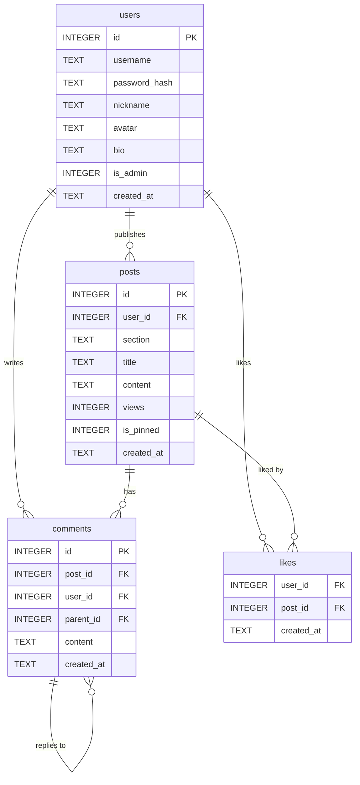
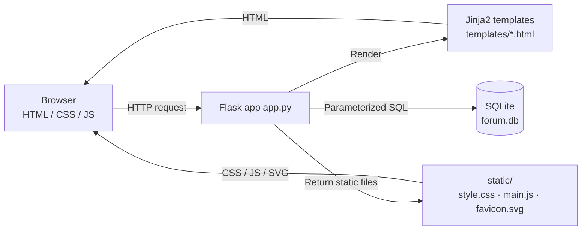

# Campus Forum

[](https://www.python.org/)
[](https://flask.palletsprojects.com/)
[](https://jinja.palletsprojects.com/)
[](https://www.sqlite.org/)
[](https://werkzeug.palletsprojects.com/)
[](https://developer.mozilla.org/en-US/docs/Web/HTML)
[](https://developer.mozilla.org/en-US/docs/Web/CSS)
[](https://developer.mozilla.org/en-US/docs/Web/JavaScript)
[](https://www.python.org/downloads/)

A lightweight campus forum based on Flask + SQLite. Single-file backend, zero frontend build, zero external CDN, and ready to run out of the box. It includes registration and login, section browsing, posting, comments and replies, likes, search, popular sorting, user profiles, profile and password settings, as well as admin pinning and content management.

---

## Table of Contents

- [Features](#features)
- [Tech Stack and Dependencies](#tech-stack-and-dependencies)
- [Project Structure](#project-structure)
- [Quick Start](#quick-start)
- [Pages and Operations](#pages-and-operations)
- [Route Overview](#route-overview)
- [Database Design](#database-design)
- [System Architecture](#system-architecture)
- [Security and Robustness Design](#security-and-robustness-design)
- [Configuration](#configuration)
- [FAQ](#faq)
- [Known Limitations](#known-limitations)
- [Author and Contact](#author-and-contact)

---

## Features

### Accounts
- Register, log in, and log out
- Username 2–20 characters (letters, digits, underscores, or Chinese characters); password at least 6 characters
- Nickname 1–20 characters; bio up to 100 characters
- 8 avatar color schemes; avatars are displayed as "first character of nickname + color block"; no image uploads
- The first registered user automatically becomes an administrator
- Changing the password requires verifying the original password

### Content
- 6 fixed sections: Study Exchange, Campus Life, Second-hand Trading, Lost and Found, Event Announcements, Off-Topic Chat
- Create posts (section + title 2–60 characters + content at least 5 characters)
- Post detail, view count, sorting by latest/popular
- Comments and second-level replies (when replying to a comment, show "Reply to @nickname")
- Like / unlike, with refresh-free frontend toggle (returns JSON)
- Keyword search (title + content)
- Pagination, 15 items per page

### Management and Personal Center
- Authors can delete their own posts/comments; administrators can delete any post/comment
- Administrators can pin/unpin posts
- User profile displays profile, post count, comment count, and post list
- Personal settings support editing nickname, avatar color scheme, bio, and password

### Interaction and Visuals
- The navigation bar always shows a "Logout" button; the post detail page provides "← Back" and "Back to section"
- Top navigation search box, section tabs, sort toggle, pagination
- Flash messages automatically fade out after 3 seconds
- Confirmation before deletion
- Responsive layout with breakpoints at 900px / 620px

---

## Tech Stack and Dependencies

### Runtime Dependencies

| Dependency | Version Requirement | Description |
| --- | --- | --- |
| Python | 3.9+ (development environment 3.11.9) | Runtime interpreter |
| Flask | >= 3.0 (development environment 3.1.3, see `requirements.txt`) | Web framework and routing |
| Werkzeug | Installed with Flask | `generate_password_hash` / `check_password_hash` password hashing |
| Jinja2 | Installed with Flask | Template engine and custom filters (`timeago`, `excerpt`) |
| SQLite | Python built-in `sqlite3` | Data storage, no extra installation required |
| HTML5 / CSS3 / JavaScript (ES6) | Natively supported by browsers | Frontend, no framework, no bundler, no CDN |

The frontend does not depend on any third-party libraries: styles are hand-written in `static/css/style.css`, interactions are hand-written in `static/js/main.js`, and icons are inline SVGs generated by template macros.

### Installation

```bash
# 1. Create and activate a virtual environment (optional, but recommended)
python -m venv .venv
# Windows PowerShell
.venv\Scripts\Activate.ps1
# macOS / Linux
source .venv/bin/activate

# 2. Install dependencies
pip install -r requirements.txt
```

Contents of `requirements.txt`:

```text
flask>=3.0
```

---

## Project Structure

```text
校园论坛/
├── app.py                  # All backend logic: database, auth, routes, template filters
├── forum.db                # SQLite database (auto-created on first launch)
├── requirements.txt        # Python dependency declaration
├── static/
│   ├── css/
│   │   └── style.css       # Site-wide styles (solid colors, thin borders, no gradients)
│   ├── js/
│   │   └── main.js         # Flash fade-out, delete confirmation, likes, comment replies
│   └── favicon.svg         # Site icon (inline SVG)
└── templates/
    ├── base.html           # Base layout: navbar, Flash, footer
    ├── _ui.html            # Macro library: linear icon icon / text avatar avatar / section badge
    ├── index.html          # Home: section tabs, sorting, post list, sidebar, pagination
    ├── post_detail.html    # Detail: back button, content, likes, comments and replies
    ├── new_post.html       # New post
    ├── user_home.html      # User profile
    ├── settings.html       # Profile and password settings
    ├── login.html          # Login
    ├── register.html       # Register
    └── error.html          # 403 / 404 error page
```

---

## Quick Start

```bash
# Run in the project root directory
python app.py
```

After startup, the terminal outputs:

```text
——————————————————————————————————————————————
Campus Forum has started!
Please visit in your browser: http://127.0.0.1:5000 !
The first registered user will automatically become an administrator!
——————————————————————————————————————————————
```

Visit <http://127.0.0.1:5000> in your browser. First register an account (the first registered account becomes the administrator), and then you can post, comment, and like.


### Database Initialization and Reset

- On first run of `python app.py`, table creation logic (`init_db()`) runs automatically; no manual database creation is needed.
- To clear all data: stop the service, delete `forum.db` in the project root directory, and start again to recreate the database.
- Legacy emoji avatar data from older versions is automatically migrated to color scheme names (such as `rose`) at startup, without errors.

### Changing the Port

By default, it listens on `127.0.0.1:5000`. To change the port, edit the end of [app.py](app.py):

```python
app.run(host="127.0.0.1", port=5000, debug=False);
```

---

## Pages and Operations

| Page | Path | Description |
| --- | --- | --- |
| Home | `/` | Section filtering, keyword search, latest/popular sorting, pagination, forum overview and popular discussions |
| Post Detail | `/post/<id>` | Content, views, likes, delete (if authorized), pin (admin), comments and replies |
| New Post | `/post/new` | Choose a section, fill in title and content |
| User Profile | `/user/<id>` | Profile, post count, comment count, and the user's post list |
| Personal Settings | `/settings` | Edit nickname, avatar color scheme, bio; separate form for password change |
| Login / Register | `/login`, `/register` | Logged-in visitors are automatically redirected back to home |
| Error Page | 403 / 404 | Unified error message and entry back to home |

UI highlights:

- Home section switching uses "text + bottom underline" tabs; the selected item shows a pink underline.
- Post cards show author avatar, section badge, title, excerpt, time, and views/likes/comments counts.
- The top-left of the post detail page always shows a "← Back" button (prefer browser history, otherwise home), with "Back to [current section]" next to it.
- Logged-in users can see the "Logout" button directly in the navigation bar (icon + text); the settings entry is a gear icon.
- If not logged in, liking redirects to the login page; after login, it automatically returns to the original page.

---

## Route Overview

| Method | Path | Function | Permission |
| --- | --- | --- | --- |
| GET | `/` | Post list (section / search / sort / pagination) | Public |
| GET, POST | `/register` | Register | Not logged in |
| GET, POST | `/login` | Login (supports in-site `next` redirect) | Not logged in |
| GET | `/logout` | Log out | Public |
| GET, POST | `/post/new` | Publish post | Login required |
| GET | `/post/<id>` | Post detail (views +1) | Public |
| POST | `/post/<id>/comment` | Post comment / reply | Login required |
| POST | `/post/<id>/like` | Toggle like, returns JSON | Login required |
| POST | `/post/<id>/delete` | Delete post | Author or admin |
| POST | `/post/<id>/pin` | Pin / unpin | Admin |
| POST | `/comment/<id>/delete` | Delete comment | Author or admin |
| GET | `/user/<id>` | User profile | Public |
| GET, POST | `/settings` | Edit profile / password | Login required |

When not logged in and accessing protected pages, a Flash message is written and the user is redirected to `/login?next=original_path`; insufficient permissions return a 403 page.

---

## Database Design

Four tables: `users`, `posts`, `comments`, `likes`. Foreign key constraints are enabled on each request connection via `PRAGMA foreign_keys = ON`.



Field descriptions:

| Table | Field | Type | Description |
| --- | --- | --- | --- |
| `users` | `id` | INTEGER PK | Auto-increment primary key |
| | `username` | TEXT UNIQUE | Login name, unique |
| | `password_hash` | TEXT | Password hashed by Werkzeug; plaintext is not stored |
| | `nickname` | TEXT | Display nickname |
| | `avatar` | TEXT | Avatar color scheme name, default `rose` |
| | `bio` | TEXT | Bio, default empty string |
| | `is_admin` | INTEGER | 1 means administrator; the first registered user is 1 |
| | `created_at` | TEXT | `YYYY-MM-DD HH:MM:SS` |
| `posts` | `user_id` | INTEGER FK | Author, references `users.id` |
| | `section` | TEXT | Section name, constrained by backend whitelist |
| | `views` | INTEGER | View count |
| | `is_pinned` | INTEGER | Whether pinned |
| `comments` | `post_id` | INTEGER FK | Post it belongs to, `ON DELETE CASCADE` |
| | `parent_id` | INTEGER FK | Comment being replied to, self-reference, nullable |
| `likes` | `user_id` + `post_id` | Composite primary key | A user can like a post only once |

Indexes: `idx_posts_section(section)`, `idx_comments_post(post_id)`. Times are stored uniformly as `%Y-%m-%d %H:%M:%S` strings and displayed by the `timeago` filter as "just now / minutes ago / hours ago / days ago / date".

---

## System Architecture



Request handling flow:

1. `before_request` reads `user_id` from the session and loads the current user into `g.user`.
2. View functions obtain a connection reused within the same request via `get_db()` (enables foreign keys, `Row` row factory).
3. `login_required` / `admin_required` decorators enforce permission checks.
4. Views query data and pass it to Jinja2 templates for rendering; templates reuse the icon and avatar macros from `_ui.html`.
5. At request end, `teardown_appcontext` closes the database connection.

---

## Security and Robustness Design

- **Passwords**: Only the result of `generate_password_hash` is stored; login checks with `check_password_hash`.
- **SQL injection**: All queries use parameterized placeholders; dynamic conditions only concatenate whitelisted fields.
- **Search wildcards**: Escape `%`, `_`, and `\` and use `ESCAPE '\'` to avoid searching `%` matching all posts.
- **Open redirect**: Login `next` only allows in-site paths starting with a single `/`, and rejects `//` and backslash forms.
- **XSS**: Templates auto-escape by default; content is rendered as plain text (`white-space: pre-wrap` preserves line breaks), with no HTML rendering.
- **Unauthorized access**: Deleting posts/comments verifies author or administrator identity; pinning is admin-only; unauthorized access returns 403.
- **Foreign key constraints**: Before deleting a post, comment self-references are cleared first; before deleting a comment, child comment references are cleared first, avoiding constraint failures during cascade; post comments and likes are cleaned by `ON DELETE CASCADE`.
- **Input validation**: Username format, nickname length, password length, title length, content length, bio length, section whitelist, and `parent_id` ownership are all validated server-side, not relying on the frontend.
- **Parameter tolerance**: Invalid page numbers (such as `?page=abc`), invalid sort parameters, unknown sections, and forged cross-post reply targets degrade safely without 500 errors.
- **Session cleanup**: After a user is deleted, the next request clears the invalid session.

---

## Configuration

| Configuration | Location | Current Value | Description |
| --- | --- | --- | --- |
| `SECRET_KEY` | `app.py` | `campus-forum-secret-key-2024` | Session signing key; replace with an environment variable before production deployment |
| `DATABASE` | `app.py` | `project_root/forum.db` | SQLite file path |
| `PAGE_SIZE` | `app.py` | `15` | Number of items per page |
| `SECTIONS` | `app.py` | 6 sections | Section whitelist, also drives home tabs and new post options |
| `AVATARS` | `app.py` | 8 color schemes | Available avatar color schemes |
| Listen address / port | End of `app.py` | `127.0.0.1:5000` | Development server listen parameters |

---

## FAQ

**Q: `Address already in use` on startup?**
A: Port 5000 is occupied. End the occupying process, or change the `app.run` port.

```powershell
# Windows: find and kill the process occupying port 5000
Get-NetTCPConnection -LocalPort 5000 -State Listen | Select-Object -ExpandProperty OwningProcess
Stop-Process -Id <PID> -Force
```

**Q: Why am I not an administrator after registering?**
A: Only the first registered account in the database is granted administrator permissions.

**Q: I changed a template or `app.py`, but the page does not change?**
A: The project runs with `debug=False`, so the service must be restarted; for pure CSS/JS changes, force-refresh the browser cache (Windows `Ctrl+F5`).

**Q: Why can't I see emoji in the UI?**
A: This is an intentional design choice. All icons are inline SVGs generated by the `icon` macro in `templates/_ui.html`; avatars are solid color blocks with the first character of the nickname.

**Q: Where is the data stored? Can it be exported?**
A: All data is in the single `forum.db` file, which can be opened, backed up, or exported with any SQLite client.

---

## Known Limitations

- Uses Flask's built-in development server, suitable only for local running and learning demonstrations, not for direct public exposure. For production deployment, use a WSGI server such as Gunicorn / uWSGI.
- CSRF Token, login failure rate limiting, attachment upload, and rich text editing are not implemented.
- No automated test files are provided; during development, Flask `test_client` with a temporary database was used for regression verification of registration/login, redirect interception, posting/commenting, unauthorized access, post/comment deletion, JSON like toggling, etc.
- The session secret is hardcoded in the source code and should be read from an environment variable before deployment.

---

## Author and Contact

**Dr. Ailan Anjuxi (谙弆悕)**

- Email: [anjuxi.ME@outlook.com](mailto:anjuxi.ME@outlook.com)
- SIP phone: [sip:anjuxi@sip.linphone.org](sip:anjuxi@sip.linphone.org)

This project is for personal learning and teaching demonstration purposes. Discussion and corrections are welcome.
